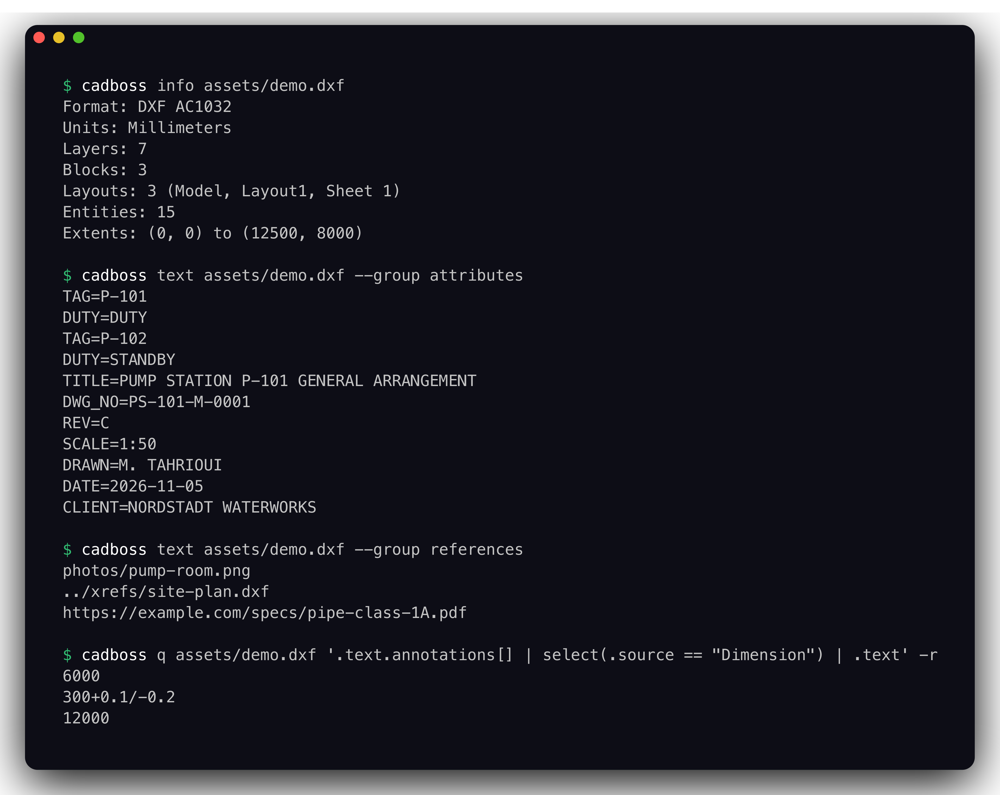
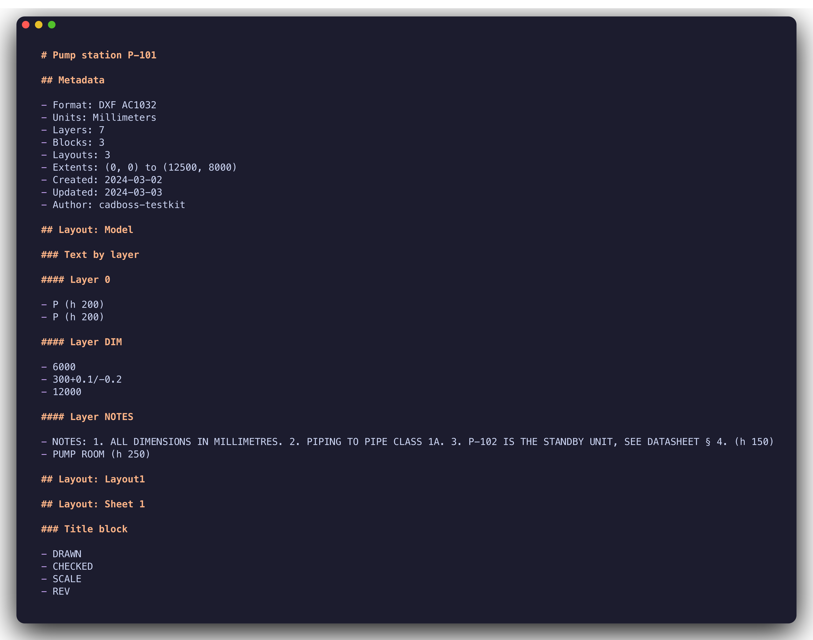

<p align="center">
  
</p>

<p align="center">
  <strong>CAD files in pure Rust: read DXF drawings, pull out every piece of text, the metadata and the structure, and hand it to a search index as Markdown or JSON. One core, a CLI, and pythonic bindings.</strong>
</p>

<p align="center">
  <a href="https://github.com/4thel00z/cadboss/actions/workflows/ci.yaml"></a>
  <a href="https://github.com/4thel00z/cadboss/actions/workflows/python-ci.yml"></a>
  <a href="https://pypi.org/project/cadboss/"></a>
  <a href="https://crates.io/crates/cadboss-cli"></a>
  
  <a href="#license"></a>
</p>

<p align="center">
  <a href="https://pypi.org/project/cadboss/">PyPI</a> ·
  <a href="https://crates.io/crates/cadboss-cli">crates.io</a> ·
  <a href="#what-comes-out">What comes out</a> ·
  <a href="#memory-and-speed">Memory and speed</a> ·
  <a href="#scope">Scope</a>
</p>

---

A drawing carries more words than it looks: the title block, the tags on every pump and valve, the notes, the dimension overrides, the layer and block names, the paths of the xrefs and images it pulls in, the hyperlinks on entities. Searching a plant's drawings means getting all of that out of files that are hundreds of megabytes, often damaged, and written by a dozen different exporters. cadboss is built for that job: a from-scratch DXF reader that lexes the whole file into a flat token tape, decodes every record in place, and returns what it could read plus a report of what it could not. No DOM, no panics, no copy of the drawing that is bigger than the drawing.

## Highlights

- **Every DXF**: ASCII and binary, R12 through R2018, Windows-1252 and ISO-8859-1 decoded, MTEXT formatting stripped (`\P`, `\N`, `\X`, stacked tolerances, `\U+XXXX`), dimension overrides substituted.
- **Text grouped the way a reader asks for it**: title block, annotations, attributes, references, names. The title block is found by block name (`TITLE`, `TBLK`, `SCHRIFTFELD`, `CARTOUCHE`) or by position on the sheet.
- **Nothing lost**: a string that does not decode travels as bytes (`{"_bytes": ...}` in JSON, `bytes` in Python) instead of a placeholder.
- **Bounded by budgets, not by the file**: bytes, tokens, entities, layouts, nesting depth and string length each have a cap; the reader stops at the cap and says so.
- **Malformed input is the normal input**: unknown entities, broken records, stray vertices, truncated sections and exceeded budgets become `Skipped { kind, reason, count }` notes, never errors. Panics are denied by the workspace lints, and a fuzz target runs in CI.
- **One pass per layout**: the ENTITIES section is bucketed once; counts, extents and text come out of one walk per layout, so a 100-layout file costs the same as a 1-layout file.
- **A terminal explorer**: `cadboss tui` browses layouts, blocks, layers and text, searches them, and shows every record as DXF pairs or a hex dump.
- **jq on the drawing**: `cadboss q` runs a jq program over the JSON export without writing it to disk.
- **A Claude Code skill**: `cadboss skill install` drops a skill that teaches the agent the commands and the output.

## Install

```bash
pip install cadboss           # prebuilt abi3 wheels (CPython 3.12+), no toolchain required
cargo install cadboss-cli     # the `cadboss` binary
```

## Usage

```bash
cadboss info    plan.dxf                                   # format, units, layers, blocks, layouts, entities, extents
cadboss text    plan.dxf --group title-block               # one group; all groups without --group, one item per line
cadboss text    plan.dxf --layout "Sheet 1"                # only that layout's text
cadboss md      plan.dxf --title "Pump plan"               # Markdown: metadata, text by layout and layer, entities, names, references
cadboss json    plan.dxf --entities --layout Model         # JSON; --entities streams every decoded entity
cadboss q       plan.dxf '.text.attributes[] | .text' -r   # jq over the JSON
cadboss layouts plan.dxf                                   # name, kind, entity count
cadboss layers  plan.dxf                                   # name, color, flags
cadboss obj     plan.dxf 1F                                # the raw group codes of one handle
cadboss tui     plan.dxf                                   # interactive explorer: outline, inspector, DXF source and hex
cadboss skill   install                                    # the bundled Claude Code skill (-g for ~/.claude)
```

Every command takes `--budget KEY=VALUE` for `max_bytes`, `max_entities`, `max_layouts`, `max_nesting`, `max_string_bytes` and `max_tokens`. Skipped content is reported on stderr. Exit codes: 1 when a file cannot be read or is not a DXF, 2 for a bad argument, an unknown layout or an invalid jq program.

The CLI memory-maps the input. Truncating or rewriting that file while `cadboss` runs can crash the process, so do not point it at a file another program is still writing; copy the file first.

<p align="center">
  
</p>

```python
import cadboss

doc = cadboss.Document.open("plan.dxf")                 # or Document.load(raw_bytes)
print(doc.format, doc.version, doc.units)
for layout in doc.layouts:                              # name, kind ("Model" or "Paper"), entity_count
    print(layout.name, layout.kind, layout.entity_count)
for item in doc.text("attributes"):                     # title-block, annotations, names, attributes, references, all
    print(item.layout, item.layer, item.text, item.height)
for skipped in doc.report():                            # what the reader could not decode, counted
    print(skipped.kind, skipped.reason, skipped.count)
open("plan.md", "w").write(doc.markdown(title="Pump plan"))
```

`Document.open` reads the file into one buffer after checking its size against `max_bytes`; `Document.load` copies the bytes it is given. Pass `budget={"max_entities": 100_000}` to either.

```rust,no_run
use std::path::Path;

use cadboss_dxf::{open_reporting, DxfDocument};

fn main() -> Result<(), Box<dyn std::error::Error>> {
    let (doc, report) = open_reporting(Path::new("plan.dxf"))?;
    println!("{} {:?}", doc.metadata.version, doc.metadata.units);
    for item in &doc.text.title_block {
        println!("{} on layer {}", item.text, item.layer);
    }
    for skipped in &report.skipped {
        println!("{:?} {:?} x{}", skipped.kind, skipped.reason, skipped.count);
    }

    let dxf = DxfDocument::open(Path::new("plan.dxf"))?;
    for entity in dxf.entities("Model") {
        println!("{entity:?}");
    }
    Ok(())
}
```

`cadboss_dxf::open` maps the file, `read` loads it into one buffer, `load` takes bytes; each has a `_reporting` twin that returns the `Report` beside the `Document`. `DxfDocument` is the layer underneath: the tape, the header, the tables, and an in-place entity decoder per layout or block.

## What comes out

`cadboss md` of [`assets/demo.dxf`](assets/demo.dxf), a pump-station layout with two tagged pumps, a title block on its own sheet, a stacked tolerance, a multi-line note, an xref, an image and a hyperlink:

<p align="center">
  
</p>

| group | what lands in it |
|---|---|
| `title-block` | TEXT and MTEXT inside a block whose name contains `TITLE`, `TBLK`, `SCHRIFTFELD` or `CARTOUCHE`, or placed in the bottom-right quarter of a paper layout |
| `annotations` | every other TEXT, MTEXT and dimension text, with position and height after the insert transform |
| `attributes` | `TAG=value` for every ATTRIB of every INSERT, bytes kept when the value does not decode |
| `references` | xref paths, image paths and PE_URL hyperlinks |
| `names` | layer and block names |

Items are ordered by layout tab, then layer, then top to bottom and left to right. `cadboss json` carries the same groups plus the metadata (version, codepage, units, author, created and updated dates, extents, per-type entity counts), the layer and layout tables, the block names and the report; `--entities` adds one array per layout with every decoded entity (lines, polylines with bulges, arcs, circles, inserts with their transform, text, dimensions, images). The `properties` group exists in the model and stays empty for DXF.

## Memory and speed

Memory is measured, not estimated. `benchmarks/memory.py` generates a 300 MB drawing with 1.7 million mixed entities and gates every run of `make bench`:

| path | peak RSS | anonymous | time | gates |
|---|--:|--:|--:|---|
| `cadboss text` (memory-mapped) | 1.76x input | 0.76x input | 1.3 s | anonymous ≤ 1.0x, RSS ≤ 2.0x |
| `Document.open(path).markdown()` (one owned buffer) | 1.87x input | 1.87x input | 1.4 s | anonymous ≤ 2.0x, RSS ≤ 2.5x |

Apple M3 Pro, release build, [`benchmarks/results-2026-11-03.json`](benchmarks/results-2026-11-03.json). The mapped file is clean, evictable memory, so the CLI gate counts it apart from what the reader allocates; the Python path owns its buffer, so its gate is one input size higher. [`benchmarks/README.md`](benchmarks/README.md) explains both.

The shapes that hurt most are flat: 40 000 text entities on 40 000 distinct layers render to Markdown in 0.04 s, 200 000 lines across 100 paper layouts export to JSON in 0.12 s, and `json --entities` on a 26 MB drawing peaks at 49 MB because the entity arrays stream instead of building a tree.

## Proof

- 248 Rust tests and 13 Python tests run on Linux and macOS in CI, with clippy and rustdoc warnings denied.
- `cargo package` builds every published crate from its packaged sources on each push, so a release cannot ship a crate that does not build on its own.
- A cargo-fuzz target seeded from the fixtures runs for a minute on each push with a per-input timeout and RSS limit.
- The public sample drawings in [`tests/samples/manifest.toml`](tests/samples/manifest.toml) (R12 to R2018, columns, alignments, lineweights) are pinned by SHA-256 and read with their text checked for leaked formatting codes.

## Layout

| path | what |
|---|---|
| `crates/cadboss-core` | source (mmap or owned bytes), budgets, report, errors, geometry |
| `crates/cadboss-model` | the format-independent document: metadata, layers, blocks, layouts, text groups, entities |
| `crates/cadboss-dxf` | the DXF reader: tape lexer, binary and ASCII, header, tables, blocks, layouts, in-place entity decoder, text groups |
| `crates/cadboss-output` | Markdown and JSON writers |
| `crates/cadboss-tui` | the terminal explorer: outline, inspector, DXF source and hex dump |
| `crates/cadboss-cli` | the `cadboss` binary and its Claude Code skill |
| `crates/cadboss-py`, `python/cadboss` | the Python package (pyo3, maturin, abi3) |
| `crates/cadboss-testkit` | a DXF builder for fixtures, the large-drawing generators and the demo drawing |
| `benchmarks/` | criterion benches and the memory gate |
| `fuzz/` | the cargo-fuzz target |

`make help` lists the targets; `make ci` runs what the Rust CI runs, `make test-py` the Python tests, `make samples` downloads and verifies the sample drawings, `make package` packages the six published crates, `make fuzz` runs the fuzz target for `FUZZ_SECONDS`.

Cargo reuses the sources it unpacked for a crate version it verified before, so a local `make package` after changing code at the same version can build stale copies; delete the `cadboss-*` directories under the nameless registry in `~/.cargo/registry/src/` first.

## Scope

Read today: DXF, ASCII and binary, R12 (AC1009) through R2018 (AC1032), codepages ANSI_1252 and ISO-8859-1. Planned, in this order: DWG, a PNG per 2D layout, STEP and IFC, the CJK codepages. Not yet read: MULTILEADER, ACAD_TABLE and ATTDEF text, codepages 1250, 1251 and 1253 to 1258. `--threads` is reserved and currently unused.

## License

MIT or Apache-2.0, at your option. See `LICENSE-MIT` and `LICENSE-APACHE`.
